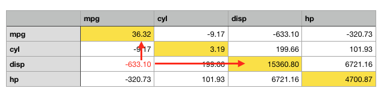

When we have a multi-trait table of data, we might be interested in investigating variability structure and the reciprocal relationships (whether causal or non-causal) among variables. For example, let's consider the 'mtcars' dataset, shown below:

```{r}
data(mtcars)
head(mtcars)
```

Considering the different cars (along the rows), we might be interested in investigating the structure of variability for fuel consumption (mpg), number of cylinders (cyl), displacement (disp) and horsepower (hp). How much does each variable change across the different cars? How much does each variable change when another variable changes? Is there any kind of joint variation, either positive or negative?

One suitable statistic to answer these question is the covariance, that is:

$$\textrm{cov}(X, Y) = \frac{1}{n - 1}\sum\limits_{i=1}^{n} {(X_i - \bar{X})(Y_i - \bar{Y})}$$

where $\bar{Y}$ and $\bar{X}$ are the means for each variable and $n$ is the number of individuals. In words, covariance is the sum of products of the i^th^ deviations from the mean for both variables. In this setting, the variance is just the covariance of a variable with itself.

For a data table, variances and covariances can be calculated by using the `cov()` function, that returns a matrix (the variance-covariance matrix, indeed):

```{r}
matr <- mtcars[,1:4]

# Covariances
Sigma <- cov(matr)
Sigma
```

While covariances indicate direction (positive or negative association), their values depend on the scale of measurement, making it difficult to gauge the strength of the relationship at a glance. For this reason, covariances are usually 'standardized' by dividing by the product of the standard deviations to obtain Pearson's correlation coefficient:

$$\textrm{cor}(X, Y) = \frac{\textrm{cov}(X, Y)}{\sigma_x \sigma_y} $$

where $\sigma_x$ and $\sigma_y$ are the standard deviations for $X$ and $Y$. Unlike covariances, correlations go from -1 to 1 and the correlation matrix has 1s along its main diagonal (since the correlation of any variable with itself is 1). In R, the matrix of correlation is obtained by using the `cor()` function:

```{r}
# Correlations
R <- cor(matr)
R
```

This brings us to the main question of this post: Given a variance-covariance matrix, can we compute the correlation matrix? And can we do the reverse—moving from a correlation matrix back to a variance-covariance matrix? With reference to the matrices above, can we go from 'Sigma' to 'R' and from 'R' to 'Sigma'? I often find myself needing to make these conversions, especially when working with mixed models or time series analysis.

# From covariance to correlation

Considering the previous expression, it is easy to see that, if we take the covariance between 'disp' and 'mpg' above (-633.0972), the correlation can be obtained as:

```{r}
-633.097208 / (sqrt(36.324103) * sqrt(15360.7998))
```

and all the necessary information is contained in the variance-covariance matrix.

Of course, doing these calculations for all covariances one by one is tedious. The question is: is there any simple way to go from a covariance matrix to a correlation matrix with one single operation?

The answer is found in matrix algebra; let's take a look at the variance-covariane matrix: what we have to do is to take each element in this matrix and divide it by the square roots of the diagonal elements in the same column and in the same row (see figure below). Consequently, our task is:

1. take the diagonal elements
2. take each i^th^ row and divide all its elements by the i^th^ diagonal element (row-scaling)
3. take each i^th^ column of the resulting matrix and divide all its elements by the i^th^ diagonal element (column-scaling)

```{r echo = F}

```

Row-scaling can be performed by using matrix-algebra; in particular, we can take a diagonal matrix of weights and multiply it by the square matrix we want to scale, as shown below. 

$$
\begin{pmatrix}
1 & 0 & 0 & 0 \\
0 & 2 & 0 & 0 \\
0 & 0 & 3 & 0 \\
0 & 0 & 0 & 4
\end{pmatrix}
\times
\begin{pmatrix}
1 & 1 & 1 & 1 \\
1 & 1 & 1 & 1 \\
1 & 1 & 1 & 1 \\
1 & 1 & 1 & 1
\end{pmatrix}
= 
\begin{pmatrix}
1 & 1 & 1 & 1 \\
2 & 2 & 2 & 2 \\
3 & 3 & 3 & 3 \\
4 & 4 & 4 & 4
\end{pmatrix}
$$

We see that all elements of the first row were multiplied by the first weighting element, all elements of the second row were multiplied by the second weighting element and so forth.

Column scaling is done similarly, but in reverse order: we take the target matrix and post-multiply it by the diagonal matrix of weights, as shown below.

$$
\begin{pmatrix}
1 & 1 & 1 & 1 \\
1 & 1 & 1 & 1 \\
1 & 1 & 1 & 1 \\
1 & 1 & 1 & 1
\end{pmatrix}
\times
\begin{pmatrix}
1 & 0 & 0 & 0 \\
0 & 2 & 0 & 0 \\
0 & 0 & 3 & 0 \\
0 & 0 & 0 & 4
\end{pmatrix}
= 
\begin{pmatrix}
1 & 2 & 3 & 4 \\
1 & 2 & 3 & 4 \\
1 & 2 & 3 & 4 \\
1 & 2 & 3 & 4
\end{pmatrix}
$$

We see that all elements of the first column were multiplied by the first weighting element, all elements of the second row were multiplied by the second weighting element, and so forth.

Consequently, we can take our variance-covariance matrix and:

1. Take the square roots of the diagonal elements (standard deviations) and load them into a diagonal matrix
2. Invert this diagonal matrix
3. Pre-multiply and post-multiply the variance-covariance matrix by this diagonal matrix of inverted standard deviations


```{r}
# from covariance to correlation - 1
StDev <- sqrt(diag(Sigma))
StDevMat <- diag(StDev)
InvStDev <- solve(StDevMat)
InvStDev %*% Sigma %*% InvStDev
```

The previous solution is correct, but, in R, it is rather inefficient. The best way is to use the `cov2cor()` function in the 'stat' package. 

```{r}
# From covariance to correlation - 2
cov2cor(Sigma)
```

With base R, we can also `sweep()` twice: 

```{r}
# From covariance to correlation - 3
sweep(sweep(Sigma, 1, StDev, FUN = "/"), 2, StDev, FUN = "/")
```

Alternatively, we can combine `scale()` and `t()` (transpose) twice, though it is noticeably less intuitive: 

```{r}
# From covariance to correlation - 4
scale(t(scale(t(Sigma), center = F, scale = StDev)), 
      center = F, scale = StDev)
```

Another very clean approach in R is based on the outer product. If we have a vectors of standard deviations ($\sigma), the outer product is:

$$
\boldsymbol{\sigma} \boldsymbol{\sigma}^T = 
\begin{pmatrix} 
\sigma_1 \\ \sigma_2 \\ \vdots \\ \sigma_n 
\end{pmatrix} 
\begin{pmatrix} 
\sigma_1 & \sigma_2 & \dots & \sigma_n 
\end{pmatrix} 
= \begin{pmatrix} 
\sigma_1 \sigma_1 & \sigma_1 \sigma_2 & \dots & \sigma_1 \sigma_n \\ 
\sigma_2 \sigma_1 & \sigma_2 \sigma_2 & \dots & \sigma_2 \sigma_n \\ 
\vdots & \vdots & \ddots & \vdots \\ 
\sigma_n \sigma_1 & \sigma_n \sigma_2 & \dots & \sigma_n \sigma_n 
\end{pmatrix}
$$

Thus, the correlation is calculated as:

```{r}
# From covariance to correlation - 5
Sigma/outer(StDev, StDev)
```

# From correlation to covariance

It is easy to see that:

$$ \textrm{cov}(X, Y) = \textrm{cor}(X, Y) \sigma_x \sigma_y$$
Thus, if we have the correlation between 'disp' and 'mpg' (-0.8521620), we can easily calculate the covariance as:

```{r}
-0.8475514 * sqrt(36.324103) * sqrt(15360.7998)
```

The only problem is that the variances are not contained in a correlation matrix, so we need to get them from elsewhere. Once we have them, we

1. 1. Take their square roots and place them into a diagonal matrix
2. Pre-multiply and post-multiply the correlation matrix for this diagonal matrix of standard deviations

The solution is as follows:

```{r}
# from correlation to covariance - 1
StDev <- sqrt(diag(Sigma))
StDevMat <- diag(StDev)
StDevMat %*% R %*% StDevMat
```

More efficiently, we can use the `cor2cov()` function in the 'lavaan' package. 

```{r}
# From correlation to covariance - 2
lavaan::cor2cov(R, StDev)
```

Or, we can `sweep()` twice: 

```{r}
# From correlation to covariance - 3
sweep(sweep(R, 1, StDev, FUN = "*"), 2, StDev, FUN = "*")
```

or `scale()` and `t()` twice: 

```{r}
# From correlation to covariance - 5
scale(t(scale(t(R), center = F, scale = 1/StDev)), 
      center = F, scale = 1/StDev)
```

Finally, we can use the outer product as follows:

```{r}
# From correlation to covariance - 6
R * outer(StDev, StDev)
```

Do you have a cleaner or faster trick for this in R? Drop a comment below and I'll be happy to feature it here!

Thanks for reading, and happy coding!

(P.S. If you enjoyed this post, check out my book "Field Research Methods in Agriculture: An Introduction with R" via the link below!)

Prof. Andrea Onofri   
Department of Agricultural, Food and Environmental Sciences   
University of Perugia (Italy)   
Send comments to: [andrea.onofri@unipg.it](mailto:andrea.onofri@unipg.it)   


<a href = "https://www.awin1.com/cread.php?awinmid=26429&awinaffid=2675822&ued=https%3A%2F%2Flink.springer.com%2Fbook%2F10.1007%2F978-3-032-08199-5"></a>
