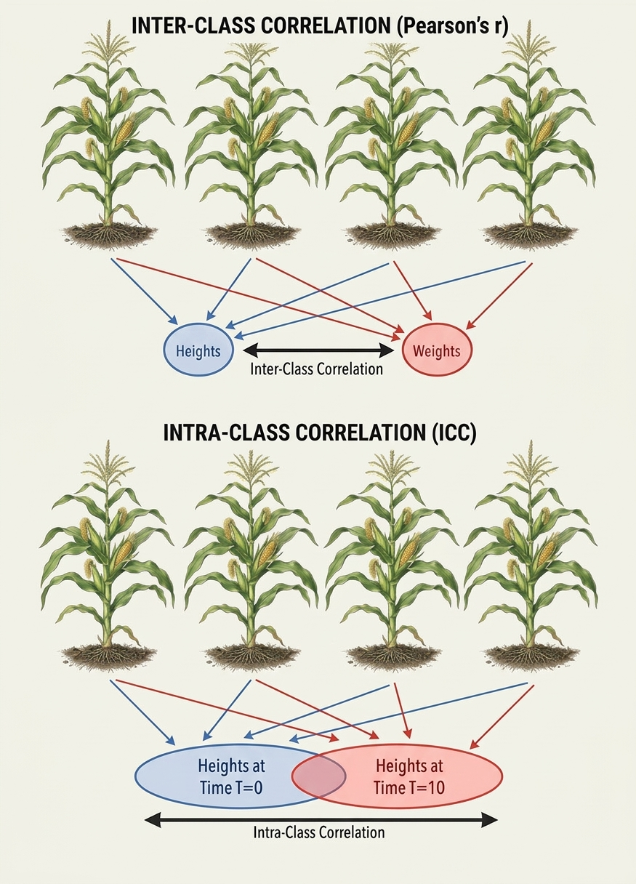

In statistics, dependence or association is any statistical relationship, whether causal or not, between two random variables or bivariate data. It is often measured by the Pearson's correlation coefficient:

$$\rho _{X,Y} =\textrm{corr} (X,Y) = \frac {\textrm{cov}(X,Y) }{ \sigma_X \sigma_Y } = \frac{ \sum_{i = 1}^n [(X - \mu_X)(Y - \mu_Y)] }{ \sigma_X \sigma_Y }$$

Other measures of correlation can be thought of, such as the Spearman $\rho$ rank correlation coefficient or Kendall $\tau$ rank correlation coefficient.

# Assumptions for the Pearson Correlation Coefficient

The Pearson correlation coefficients makes a few assumptions, which should be carefully checked.

1. **Interval-level measurement:** Both variables should be measured on a quantitative scale.
2. **Random sampling:** Each subject in the sample should contribute one value on $X$ and one value on $Y$. The values for both variables should represent a random sample drawn from the population of interest.
3. **Linearity:** The relationship between $X$ and $Y$ should be linear.
4. **Bivariate normal distribution:** This means that (i) the values of $X$ follow a normal distribution at each level of $Y$, and (ii) the values of $Y$ follow a normal distribution at each level of $X$.


# Hypothesis testing

It is possible to test whether $r = 0$ against the alternative $ r \neq 0$. The test is based on the test statistic:

$$ T = \frac{r \sqrt{n - 2}}{\sqrt{1 - r^2}}$$
which follows a Student's $t$ distribution with $n-2$ degrees of freedom.

Let's take the two variables `cyl` and `mpg` from the `mtcars` data frame. For these variables, the Pearson's correlation index is (please note, that the Spearman's correlation doefficient might be preferred for these variables, although I neglected this for the sake of simplicity):

```{r}
r <- cor(mtcars$cyl, mtcars$gear)
r
```

The T statistic is:

```{r}
T <- r * sqrt(32 - 2) / sqrt(1 - r^2)
T
```

The p-value for the null hypothesis is:

```{r}
2 * pt(T, 30)
```

which is clearly highly significant. The null can be rejected.

When performing this test, it is important to note that the individuals from whom the pairs of measurements were taken must be independent. If they are not, the 't-test' is invalid. I discuss this aspect in another post on my blog.


# Correlation in R

We have already seen that we can use the standard cor(matrix, method = ...) function. To obtain significance levels as well, we can use the `rcorr()` function from the 'Hmisc' package:

```{r message=FALSE, warning=FALSE, paged.print=FALSE}
# Correlations with significance levels
library(Hmisc)
corr2 <- rcorr(as.matrix(mtcars), type="pearson")
print(corr2$r, digits = 2)
print(corr2$P, digits = 2)
```

We can also use these functions with two separate matrices to obtain the correlations between each column of one matrix and each column of the other:

```{r}
# Correlation matrix from mtcars
x <- mtcars[1:3]
y <- mtcars[4:6]
cor(x, y)
```


# Relationship to slope in linear regression

The correlation coefficient and the slope in linear regression share some similarities, as both describe how $Y$ changes with $X$. However, in correlation, we deal with two random variables, whereas in simple linear regression we treat $X$ as fixed and $Y$ as a random variable, with $Y$
regarded as a function of $X$ (and not the other way around).

Despite their distinct interpretations, it is useful to examine the algebraic relationship between the correlation coefficient and the regression slope. Let's simulate a dataset with two variables drawn from a multivariate normal distribution, with means of 10 and 2, respectively, and a variance-covariance matrix of:

```{r}
library(MASS)
cov <- matrix(c(2.20, 0.48, 0.48, 0.20), 2, 2)
cov
```

We use the `mvrnomr()` function to generate the dataset.

```{r}
set.seed(1234)
dataset <- data.frame( mvrnorm(n=10, mu = c(10, 2), Sigma = cov) )
names(dataset) <- c("X", "Y")
dataset
```

The correlation coefficient and slope are as follows:

```{r}
r <- with(dataset, cor(X, Y))
b1 <- coef( lm(Y ~ X, data=dataset) )[2]
r
b1
```

The formula for the slope is:

$$b_1 = \frac{ \sum_{i = 1}^n \left[ ( X-\mu_X )( Y-\mu_Y )\right] }{ \sigma^2_X } $$

From this, we see that:

$$ r = b_1 \frac{\sigma_X}{ \sigma_Y }$$

and:

$$ b_1 = r \frac{\sigma_Y}{\sigma_X}$$

Indeed:

```{r}
sigmaX <- with(dataset, sd(X) )
sigmaY <- with(dataset, sd(Y) )
b1 * sigmaX / sigmaY 
r * sigmaY / sigmaX
```

It is also easy to see that the correlation coefficient is equivalent to the regression slope of standardized $Y$ against standardised $X$:

```{r}
Yst <- with(dataset, scale(Y, scale=T) )
summary( lm(Yst ~ I(scale(X, scale = T) ), data = dataset) )
```


# Intra-class correlation (ICC)

This is a related yet distinct concept. While Pearson's correlation coefficient is used for bivariate data—where two different variables are observed on the same independent units—intraclass correlation arises when the same variable is repeatedly observed on the same units (e.g., across different times or spaces), so that each unit acts as a grouping factor that creates clusters of measurements.

Let's illustrate this with an example. Consider the following data table:

```{r}
#|echo: false
m1 <- c(10, 12, 13, 16)
m2 <- c(21, 20, 17, 19)
dtab <- cbind(m1, m2)
row.names(dtab) <- paste0("g", 1:4)
knitr::kable(dtab)
```

When g1, g2, g3, and g4 represent four independent units (e.g., four maize plants) on which two variables, m1 and m2 (e.g., weight and height), were measured, we are in the realm of Pearson's correlation. On the other hand, when g1, g2, g3, and g4 are entities on which multiple measurements of the same variable (e.g., yield) are taken, we enter the realm of intraclass correlation. In this second scenario, we are not assessing joint variability between two different variables; rather, we want to determine whether belonging to the same group ('proximity') makes observations more similar to each other than observations from different groups.

```{r}
#| label: fig-icc
#| fig-cap: "Confronto concettuale tra Pearson e ICC"
#| out.width: "85%"
#| echo: false


```

The most common intraclass correlation coefficient is:

$$ICC = {\displaystyle {\frac {\sigma _{\alpha }^{2}}{\sigma _{\alpha }^{2}+\sigma _{\varepsilon }^{2}}}.}$$

where $\sigma _{\alpha }^{2}$ is the between-group variance component and $\sigma _{\varepsilon }^{2}$ is the within-group variance component (or, more clearly, the variance of observations within a group). For balanced data, those two components can be obtained from one-way ANOVA, considering that there are four 'replicates' per group:

```{r}
y <- c(10, 12, 13, 16, 21, 20, 17, 19)
group <- factor( rep(c("A", "B"), each = 4) )
nmeasures <- 4
mod <- lm(y ~ group)
anova(mod)
sigma2_alpha <- (84.5 - 4.583)/nmeasures
sigma2_epsilon <- 4.583
icc <- sigma2_alpha/(sigma2_alpha + sigma2_epsilon)
icc
```

In general, if subjects in one group are very similar (small $\sigma_{\varepsilon}$), while different groups vary widely (high $\sigma_{\alpha}$), the ICC is high. Conversely, if measurements are just as similar across different groups as they are within the same group, the ICC is low. In theory, the ICC cannot be negative, as variance components are expected to be positive. In practice, however, the ICC calculated via the method of moments shown above can turn out negative when the group mean square is lower than the residual mean square from the ANOVA. Such negative values are usually constrained to zero or interpreted as indicating an absence of positive clustering; in both cases, intraclass correlation remains a meaningful tool.

ICC is crucial and is most often studied using linear mixed models. But... that is a story for another day...

Thanks for reading, and happy coding!

(P.S. If you enjoyed this post, check out my book "Field Research Methods in Agriculture: An Introduction with R" via the link below!)

Prof. Andrea Onofri   
Department of Agricultural, Food and Environmental Sciences   
University of Perugia (Italy)   
Send comments to: [andrea.onofri@unipg.it](mailto:andrea.onofri@unipg.it)   


<a href = "https://www.awin1.com/cread.php?awinmid=26429&awinaffid=2675822&ued=https%3A%2F%2Flink.springer.com%2Fbook%2F10.1007%2F978-3-032-08199-5"></a>

---

This post was originally published on 2019-02-07


